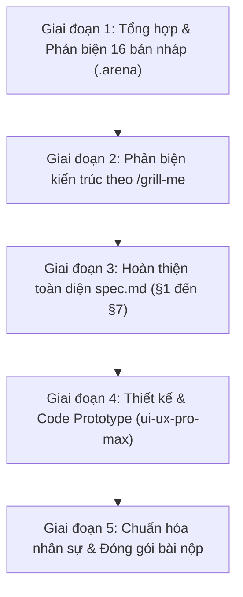

# Nhật Ký Hoạt Động Của AI (AI Activity Log)

**Dự án:** LAB5 — AI Product UX & Autonomy · Track T4 (E-commerce)  
**Nhóm sinh viên:** Nhóm 3 chàng ngự lâm (Lớp L3A · Zone C4)  
**Thành viên:** Nguyễn Đức Trung (Trưởng nhóm), Bùi Văn Lâm, Đỗ Minh Hiếu, Nguyễn Huy Thụ  
**Thời gian thực hiện:** Ngày 12/11/2026  
**Mục tiêu:** Hoàn thiện đặc tả thiết kế sản phẩm AI (`spec.md`), xây dựng sản phẩm mẫu tương tác (`prototype/index.html`), và tài liệu hướng dẫn thuyết trình demo (`README.md`).

---

## 1. Tổng quan các giai đoạn thực hiện

---

## 2. Chi tiết từng giai đoạn công việc

### Giai đoạn 1: Tổng hợp & Phản biện 16 bản nháp (§2 Kịch bản rủi ro)
* **Dữ liệu đầu vào:** 16 bản nháp (`a001.md` – `a016.md`) và 5 bản đối kháng phản biện (`r1-m03`, `r1-m04`, `r1-m05`) tại `.arena\run-20261112-151721-s23697\`.
* **Phát hiện & Sửa chữa các bẫy logic cốt lõi:**
  * **Bẫy xung đột chính sách ở ca tai nghe giả:** Bản nháp cũ chọn "tai nghe không chính hãng" vào top 2, nhưng theo Rubric riêng mục 5 thì nghi vấn hàng giả phải chuyển bộ phận chuyên trách, không thuộc luồng khiếu nại thường. AI đã thay bằng ca #5 (Áo chuẩn size L ngực 96cm, tem khớp mô tả nhưng khách mặc chật do form ôm body).
  * **Ranh giới công cụ & Lỗ hổng dữ liệu (Gaps):** Xác định hệ thống chỉ có đúng 5 tools (`yeu_cau_bang_chung`, `chuyen_truong_nhom`, `soan_hoan_tien`, `tu_choi_khieu_nai`, `phat_shop`). Làm rõ việc thiếu tool đọc snapshot mô tả lúc mua, thiếu tool đọc chat, và không có thời hạn trả hàng cấp sẵn trong đề.
  * **Chốt dữ liệu dựng (Fixture Data):** `H_TRA = 7 ngày` (khác mốc 15 ngày của Shopee thật ngoài đời); `H_PHAN_HOI = 48 giờ` để người bán phản hồi.
* **Xây dựng Bảng 10 kịch bản rủi ro hoàn chỉnh:**
  * Phủ đủ 4 lớp: Lớp ① (Nguồn sự thật: #2, #4, #9), Lớp ② (Mơ hồ/thiếu dữ liệu: #1, #10), Lớp ③ (Ngoài thẩm quyền: #7, #8), Lớp ④ (Đặc thù domain TMĐT: #3, #5, #6).
  * Đầy đủ 3 tin mồi, 6 ca kiểm thử khó (Hard tests) và tiếng nói người dùng ("Tôi gửi ảnh rồi mà cứ bị hỏi lại" -> #10).
  * Chuẩn hóa nhãn dứt khoát không điều kiện: 1 nhẹ (#9), 1 sửa được (#10), 8 không chấp nhận được (#1-#8). Đánh dấu rõ ca "đúng nhờ may" (#2).
* **Lập luận chọn 2 kịch bản đắt nhất theo ma trận 4 tiêu chí:**
  * **#4 (Mô tả bị sửa sau khi bán):** AI đối chiếu mô tả hiện tại rồi gọi `tu_choi_khieu_nai`, người mua mất tiền qua lỗi im lặng (xử ép người mua).
  * **#5 (Người bán đúng / tem khớp mô tả):** AI gọi `soan_hoan_tien` để dẹp chuyện, người bán mất hàng và tiền dù làm đúng 100% (xử ép người bán).
  * Thử thách đúng bài toán cốt lõi của đề: **Sự trung lập hai chiều**.
* **Đầu ra:** Xuất file [synthesis.md](file:///C:/Users/OS/Downloads/VinAI/.arena/synthesis.md) và thay thế vào `spec.md`.

---

### Giai đoạn 2: Phỏng vấn phản biện thiết kế qua Slash Command `/grill-me`
AI đã kích hoạt quy trình phỏng vấn từng nhánh quyết định với sinh viên (kèm phương án khuyến nghị):
1. **Nhánh §3 (Chiến lược khi AI không chắc):** Thống nhất chọn *Trả lời kèm giới hạn & Mở luồng đối chất song phương 48h* (tuân thủ HAX G10).
2. **Nhánh §3 (Nguyên tắc HAX/PAIR):** Chốt 3 nguyên tắc: **HAX G10** (Thu hẹp phạm vi khi nghi ngờ), **HAX G11** (Giải thích vì sao), và **PAIR Explainability & Trust** (Thẻ đối soát minh bạch).
3. **Nhánh §4 (Mức tự chủ của 5 tools):** Thống nhất giữ nguyên 5 tool gốc, phân bổ theo Cost-of-Error; tool khó xếp nhất là `soan_hoan_tien` (được cấu hình 2 tầng duyệt: Shop duyệt trước -> Trưởng nhóm sàn duyệt khi tranh chấp).
4. **Nhánh §5 (Bố cục Prototype):** Thống nhất mô hình **Màn hình kép song song (Dual-Pane)** mô phỏng Người mua (Mobile App) và Người bán (Kênh người bán Web) kèm công tắc "Chế độ Chấm thi".
5. **Nhánh §7 (Kịch bản demo):** Chốt cơ cấu thuyết trình 4 phút và 2 phương án đối phó "ca lạ" tại chỗ.

---

### Giai đoạn 3: Hoàn thiện toàn diện tài liệu đặc tả `spec.md`
Cập nhật đầy đủ cả 7 phần theo đúng thang điểm Rubric 100 điểm:
* **§1. Lát cắt & phạm vi:** Định nghĩa rõ lát cắt trung lập và 3 điều kiên quyết không làm.
* **§2. Kịch bản rủi ro:** Đưa bảng 10 kịch bản, ma trận chọn 2 ca đắt nhất, lý do loại các ca suýt chọn (#7 khoá shop, #6 doạ bóc phốt, #3 nồi chiên), và 7 điểm phản biện bản nháp cũ.
* **§3. Khi AI sai:** Soạn câu thoại nguyên văn của AI, mô tả thẻ đối chiếu chứng cứ, các nút bấm thao tác cho cả khách và shop, phân loại lỗi ngữ cảnh vs lỗi người dùng, và phân tích lỗi không sửa được bằng câu chữ.
* **§4. Mức tự chủ:** Lập luận chi phí sai lầm cho 5 tools, phân tích sâu tool khó xếp nhất `soan_hoan_tien`, thử nghiệm mức tự chủ trên 3 ca (#4, #5, #2), và tuyên bố sự thay đổi lời hứa thương hiệu.
* **§5. Prototype:** Tài liệu hóa kiến trúc sản phẩm mẫu, bảng đánh số 6 vị trí trỏ tiêu chí rubric.
* **§6. Tốt là gì:** 3 tiêu chí Pass/Fail chấm được độc lập, tự chấm trên #4 và #5, ghi nhận thách thức OCR hình ảnh.
* **§7. Kế hoạch Demo:** Kịch bản thuyết trình chia theo mốc thời gian và phương án xử lý 2 ca lạ (Nồi chiên 6L vs 5L; Kem dưỡng nghi hàng giả).

---

### Giai đoạn 4: Thiết kế & Xây dựng Prototype Tương Tác (`prototype/index.html`)
Áp dụng Design Intelligence từ skill **`ui-ux-pro-max`**:
* **Hệ thống Design System:** 
  * Bảng màu Shopee Brand: `#EE4D2D` (Primary Orange), `#D03B1E` (Hover Dark), `#FFF5F1` (Background Light), `#1E293B` (Text Slate), `#10B981` (Success Green).
  * Typography: Google Fonts Nunito Sans (Body) & Rubik (Heading).
  * Iconography: SVG Lucide chuẩn (không dùng emoji làm icon).
* **Kiến trúc Màn hình kép tương tác (Dual-Pane Layout):**
  * **Cột trái — Ứng dụng Di động Shopee (Góc nhìn Người mua):** Khung điện thoại mockup, hiển thị hội thoại chat AI mượt mà, thẻ đối soát thông số 2 cột, nút nộp ảnh lúc đặt hàng, nút gọi nhân viên hỗ trợ (`chuyen_truong_nhom`).
  * **Cột phải — Kênh Người Bán (Shopee Seller Centre):** Bảng quản lý khiếu nại, đồng hồ đếm ngược **48 giờ** chạy thời gian thực bằng JavaScript, hiển thị chứng cứ khách gửi, nút `[Chấp thuận hoàn tiền]` (Lớp 1 của `soan_hoan_tien`) và nút `[Shop gửi khiếu nại đối chất]` (`chuyen_truong_nhom`).
* **Tính năng hỗ trợ Chấm thi (Exam / Rubric Mode):**
  * Công tắc chuyển đổi trên header: Khi bật sẽ tự động hiển thị các huy hiệu nhấp nháy: `[HAX G10]`, `[HAX G11]`, `[PAIR Trust]`, `[Mức tự chủ: Cần duyệt]`. Giúp nhóm trả lời ngay lập tức câu hỏi của Giám khảo: *"Chỉ cho tôi chỗ nào trên màn hình là G__"*.
* **Bộ chuyển kịch bản 1-chạm:** Chuyển đổi qua lại giữa Kịch bản #4, Kịch bản #5 và Ca lạ Nồi chiên 6L.

---

### Giai đoạn 5: Chuẩn hóa Nhân sự & Hoàn tất Bài nộp
* **Bổ sung thành viên Bùi Văn Lâm (Mã học viên: 2A202603400):** Cập nhật vai trò **Thành viên** phụ trách kiến trúc hệ thống, xây dựng Prototype tương tác (§5) và điều khiển demo ca khó.
* **Đồng bộ bảng nhân sự trên toàn bộ hệ thống file:**
  * [spec.md](file:///c:/Users/OS/Downloads/VinAI/K5-L3A-Day05-T4-3_chang_ngu_lam/spec.md): Bảng thành viên đầu trang và kịch bản phân vai mục §7.1.
  * [README.md](file:///c:/Users/OS/Downloads/VinAI/K5-L3A-Day05-T4-3_chang_ngu_lam/README.md): Bảng thành viên, link truy cập tài liệu và hướng dẫn chạy demo dưới 30 giây.
  * [prototype/index.html](file:///c:/Users/OS/Downloads/VinAI/K5-L3A-Day05-T4-3_chang_ngu_lam/prototype/index.html): Huy hiệu định danh nhóm và thành viên trên thanh tiêu đề.

---

## 3. Bảng Kiểm Tra Sẵn Sàng Báo Cáo (Readiness Checklist)

| Tiêu chí Rubric | Trạng thái | Nơi kiểm chứng |
|---|:---:|---|
| **R1 · Lát cắt & phạm vi (5đ)** | ĐẠT | `spec.md` §1 (Đúng lát cắt trung lập, đủ 3 việc cấm làm) |
| **R2 · Kịch bản rủi ro (10đ)** | ĐẠT | `spec.md` §2 (10 kịch bản phủ 4 lớp, 2 ca đắt nhất, ma trận 4 tiêu chí) |
| **R3 · Khi AI sai (25đ)** | ĐẠT | `spec.md` §3 (Câu nói nguyên văn, thẻ đối soát, 3 nguyên tắc HAX/PAIR, lỗi không sửa được bằng câu chữ) |
| **R4 · Mức tự chủ (25đ)** | ĐẠT | `spec.md` §4 (5 tools xếp theo Cost-of-error, phân tầng duyệt `soan_hoan_tien`, thử 3 ca) |
| **R5 · Prototype (25đ)** | ĐẠT | `prototype/index.html` (Màn hình kép tương tác, công tắc Chế độ Chấm thi) |
| **R6 · Tốt là gì (5đ)** | ĐẠT | `spec.md` §6 (3 tiêu chí Pass/Fail chấm độc lập) |
| **R7 · Demo & Phân công (5đ)** | ĐẠT | `spec.md` §7 & `README.md` (Phân vai 4 thành viên, kịch bản 2 ca lạ) |
| **Quy định an toàn & Vibe-coding** | ĐẠT | Mọi thành viên đều có phần việc cụ thể và trả lời được: *"Sai thì ai mất gì?"* |
